  

  
  
  

  

<h2 align="center">👨‍💻 About Me</h2>

  I'm a Software Engineer currently studying at <b>NIBM University, Sri Lanka</b> 🎓 
  I'm a passionate learner who's always willing to learn and work across technologies and domains 💡 
  I love to explore new technologies and leverage them to solve real-life problems ✨ 
  Apart from that, I also love to guide and mentor newbies 🤝

  
  
  

<h2 align="center">Technology Stack </h2>

<h2 align="center">⚡️ Social Media</h2>

<h2 align="center">My Github Stats 📊</h2>

  
  

<h2 align="center">🏆 Trophies</h2>

  

<h2 align="center" id="github-contribution-streak">Github Contribution Streak & Contribution Graph 📈</h2>

    

<h2 align="center">💬 Quote of the Moment</h2>

  

    <picture align="center">
      <source media="(prefers-color-scheme: dark)" srcset="https://raw.githubusercontent.com/Niefee/niefee/master/assets/github-contribution-grid-snake.svg">
      <source media="(prefers-color-scheme: light)" srcset="https://raw.githubusercontent.com/Niefee/niefee/master/assets/github-contribution-grid-snake.svg">
      
    </picture>

  

